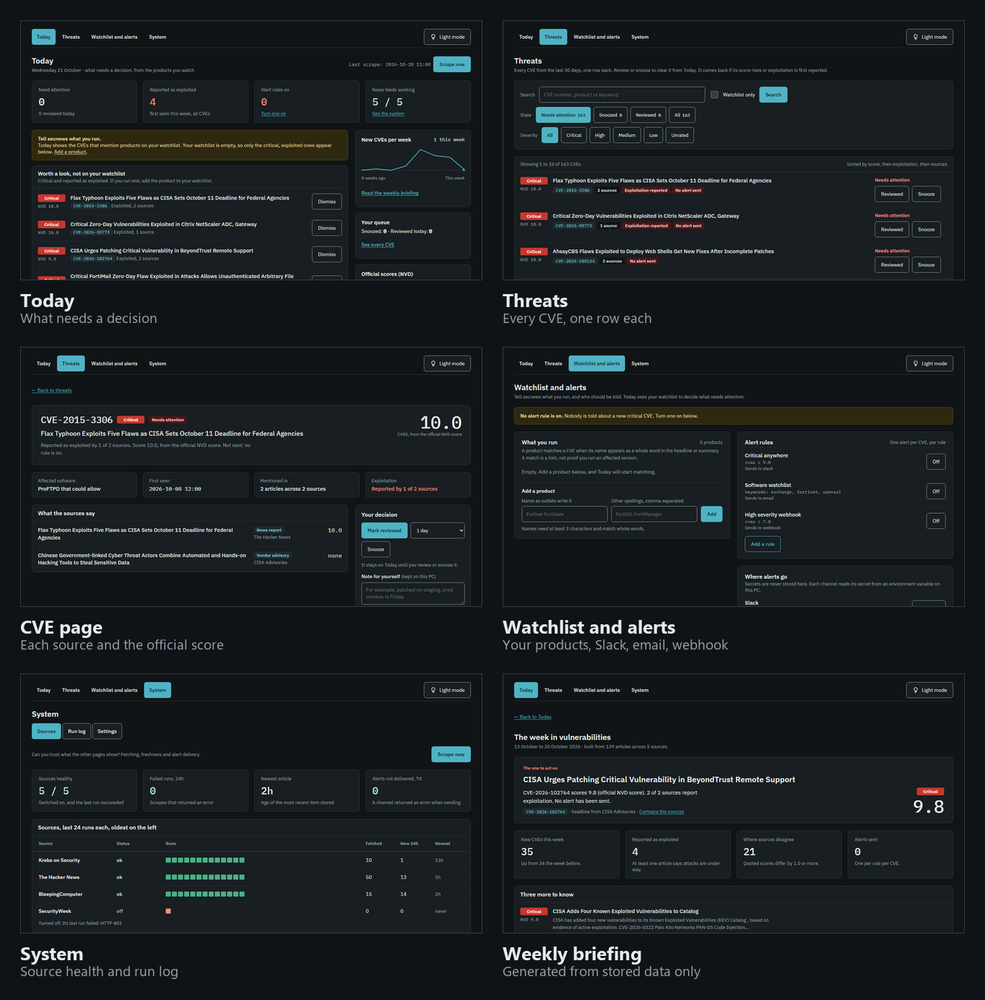
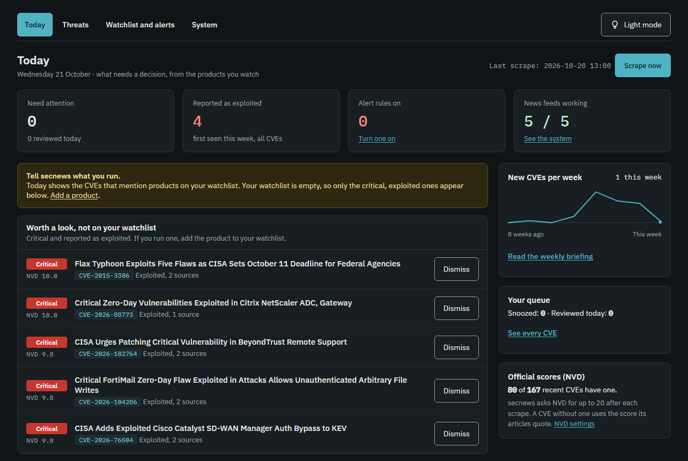
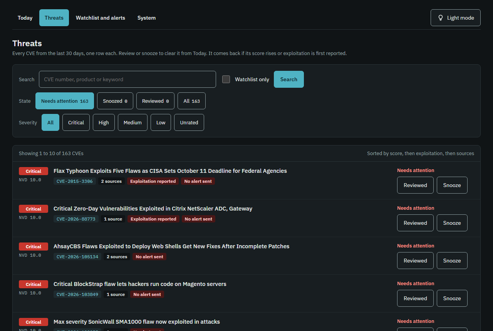
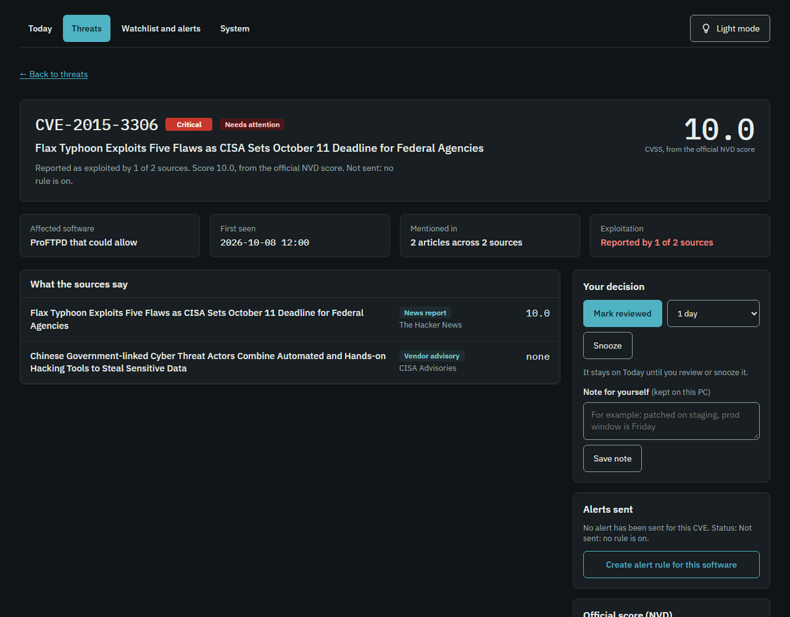
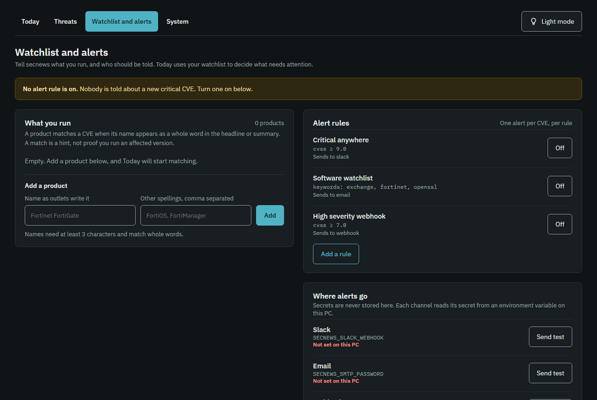
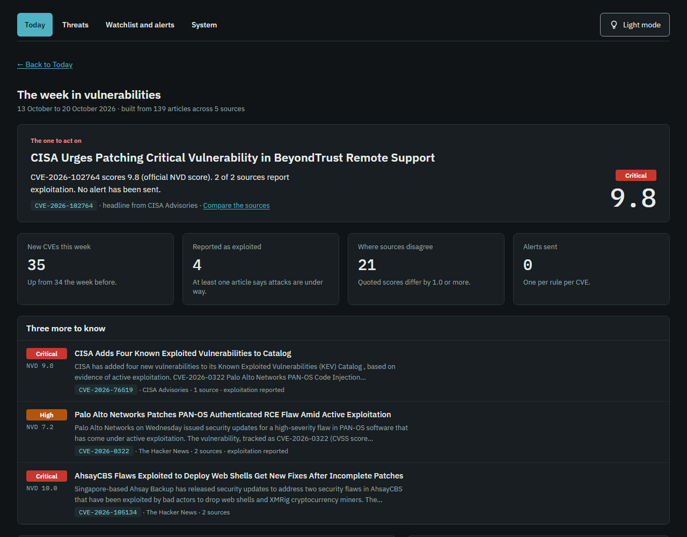
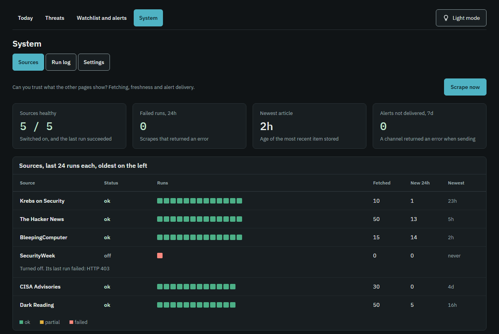

# secnews

Collects cybersecurity news from Krebs on Security, The Hacker News, BleepingComputer and SecurityWeek, extracts CVE identifiers, stores everything in SQLite, and shows it on a local dashboard. It can alert you by Slack, email or webhook.



## Main features

| Feature | What it gives you |
|---|---|
| **Today** | A short list of what needs a decision: CVEs that match your watchlist, then critical ones reported as exploited. Mark Reviewed or snooze. |
| **Threats** | Every CVE from the last 30 days, one row each, with state tabs, severity chips and search. |
| **Official scores** | The NIST NVD score replaces the one an article quotes. A CVE with no score is marked Unrated, never guessed. |
| **One CVE, many sources** | The same CVE from different sites is merged. The CVE page shows each source's score and flags disagreement. |
| **Watchlist and alerts** | List the products you run. Alert rules send to Slack, email or a webhook, once per CVE. |
| **Weekly briefing** | A one-page summary written only from stored data: the CVE to act on, new CVEs, exploited ones and where sources disagree. |
| **System** | Source health, a run log and settings, so you can tell whether to trust what the other pages show. |
| **Polite and local** | Checks robots.txt, rate limits requests, keeps secrets in environment variables and binds to `127.0.0.1` only. |

### Today


### Threats


### One CVE, every source


### Watchlist and alerts


### Weekly briefing


### System


Screenshots show live data from one instance. The headlines come from public security news sites.

## Setup (Windows)

```powershell
python -m venv .venv
.\.venv\Scripts\python -m pip install -r requirements.txt
.\.venv\Scripts\python -m secnews init
.\.venv\Scripts\python -m secnews scrape      # first run
.\.venv\Scripts\python -m secnews serve       # http://127.0.0.1:5000, with the scheduler
```

Before you scrape regularly, put a real contact address in `fetching.user_agent` in `config.yaml`, so site owners can reach you.

## Commands

| Command | What it does |
|---|---|
| `scrape [--source NAME]` | Fetch sources now, then evaluate alert rules |
| `search --q X --severity High --source NAME --cve CVE-... --from 2026-10-01 --to 2026-10-08 --page 2` | Search stored articles |
| `cve CVE-2026-0001` | One CVE with every article, scores and alerts |
| `log [--failures] [--kind Alert]` | The run log |
| `reindex` | Re-extract CVEs and scores from stored articles after the extraction rules change |
| `alerts-test slack\|webhook\|email` | Send a test message |
| `serve [--port N] [--no-scheduler]` | Dashboard and scheduler |
| `schedule` | Scheduler only, no web UI |

The dashboard has four pages, in one light and dark theme that follows your system setting:

- **Today**: what needs a decision. CVEs that match your watchlist, then critical exploited ones that do not. Each can be marked Reviewed or snoozed (1 day, 3 days, 1 week, or until the score changes), with an Undo bar.
- **Threats**: every CVE from the last 30 days, one row each, with state tabs, severity chips, search and a watchlist filter, 10 per page.
- **Watchlist and alerts**: the products you run, alert rules (on/off), and whether each alert channel's secret is set.
- **System**: Sources (health and alert delivery), Run log, and Settings.

Opening a CVE shows each source's score, your decision buttons, notes (kept in the local database), and what happened to it. The weekly briefing is linked from Today.

A reviewed or snoozed CVE leaves Today and comes back by itself if its score rises or exploitation is first reported (a snooze also ends on time). **Official scores (NVD).** After each scrape, secnews asks the NIST National Vulnerability Database for the official CVSS score of CVEs it found in the news. Only the CVE numbers are sent, one request each, through NVD's public API. The official score replaces the one an article quotes, and a CVE whose articles disagree with NVD is flagged. CVEs NVD has not analysed yet are asked about again after 6 hours, and scored ones are refreshed after a week. Without an API key NVD allows 5 requests per 30 seconds, so each cycle asks about at most `max_per_run` CVEs (20 by default, about 2 minutes) and the backlog clears over several cycles. A free key from nvd.nist.gov raises the limit: put it in the environment variable named by `nvd.api_key_env` (default `NVD_API_KEY`), never in `config.yaml`. Settings has the switch. `python -m secnews nvd --all` clears the backlog now. A newly fetched official score that is higher than the score you reviewed a CVE at brings it back to Today. If NVD is down or rate limits you, the run stops, is logged as a failure in the run log, and alerts still go out.

**Watchlist.** Add the products you run on the Watchlist and alerts page (they are saved under `watchlist:` in `config.yaml`). A product matches a CVE when its name, or an extra term you give it, appears as a whole word in the CVE's headlines, summaries or affected phrase. In an article that names more than 3 CVEs, only the text within 200 characters of the CVE's ID counts. Each match shows the text it matched on. Treat a match as a hint: it does not know which version you run. The briefing's sentences are generated from stored data only. Excerpts are cut at a word boundary and end with an ellipsis. Fonts are bundled in `secnews/static/fonts`, so nothing loads from an external site. It binds to `127.0.0.1` only. There are no user accounts, so do not expose it to a network.

## How the data is handled

- **Duplicates.** An article is skipped if its URL or its content hash is already stored.
- **Same CVE from several sources.** Each article keeps its own CVE row. The CVE page groups them and shows how many sources cover it. The feed ranks by severity, then source count, then date.
- **Conflicting scores.** Scores are stored per article. The CVE page shows the vendor advisory's score if there is one, otherwise the highest reported, and flags the disagreement.
- **Unrated.** If no CVSS score is found near a CVE mention, the CVE is marked Unrated. It is never guessed.
- **Alerts.** A rule alerts once per CVE. It alerts again only if the CVSS rises or exploitation is first reported (switch off with `realert_on_change: false`). Quiet hours hold alerts back until the window ends.
- **Failures.** Each run is written to the `runs` table. A source that fails never stops the others. A channel that fails is logged once per cycle.

## Configuration

Everything is in `config.yaml`. The Settings page edits the same file (YAML comments are not preserved when it saves). Secrets are never stored in it: give the name of an environment variable.

```powershell
setx SECNEWS_SLACK_WEBHOOK "https://hooks.slack.com/services/..."   # then reopen the terminal
.\.venv\Scripts\python -m secnews alerts-test slack
```

Alert rules ship disabled. Enable one on the Settings page after its channel passes `alerts-test`.

Sample source entry (RSS, the default):

```yaml
- name: BleepingComputer
  feed: https://www.bleepingcomputer.com/feed/
  enabled: true
```

Fallback for a site with no usable feed (HTML listing; check the site's terms and robots.txt first):

```yaml
- name: Example
  html: {url: https://example.com/security/, link_selector: "h2 a"}
```

## Scheduling

`serve` and `schedule` use APScheduler and run every `scheduler.interval_minutes`. If you prefer the operating system, disable the in-app scheduler and run `secnews scrape` from Windows Task Scheduler (or cron on Linux).

## Scraping ethics and limits

- RSS feeds are used because publishers provide them for this purpose and they break less than page scraping.
- robots.txt is always checked. A disallowed URL is not fetched.
- Requests are limited to one per second per host, with a timeout, retries with backoff, and a User-Agent that identifies the tool.
- Only titles, summaries and feed text are stored for your own analysis. Do not republish them.
- If a site blocks the tool (SecurityWeek returned HTTP 403 in testing), the run log shows it. Do not work around it by disguising the User-Agent. Contact the site or drop the source.
- Read each site's terms of service before using the HTML fallback.

## Official records versus news

News articles quote scores that can differ from the official record, and the "Vendor advisory / News report / Researcher write-up" label is guessed from the headline. Treat the dashboard as a lead generator. Confirm severity, affected versions and fixes in the vendor advisory or the NVD before acting.

## Using it in incident response

- Create a rule for the products you run (keywords such as `exchange, fortinet, openssl`) and send it to the channel your on-call team watches.
- Use `secnews cve CVE-...` or the CVE page as the starting note for a ticket: sources, scores, first-seen time and exploitation status are all there.
- The webhook channel posts JSON (`cve_id`, `severity`, `cvss`, `exploited`, `url`, `rule`), so it can feed a ticketing or SOAR tool.

## Tests

```powershell
.\.venv\Scripts\python -m pytest tests -q
```

Tests use saved feed fixtures and a fake HTTP session. They make no network calls.

## Known limits

- CVSS extraction is pattern-based. It finds common phrasings ("CVSS 9.8", "9.8 on CVSS") but not every one.
- "Affected software" is a best-effort phrase from the text near the CVE mention.
- No digest mode: alerts are sent immediately (outside quiet hours).
